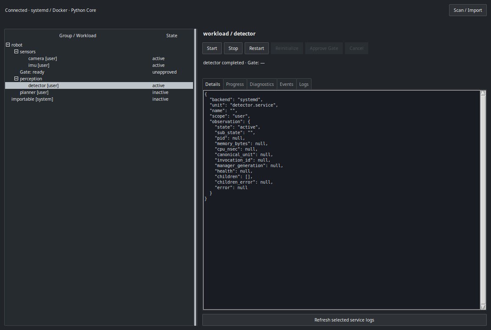

# devdash

**Python + ttkbootstrap / Tkinter**製のLinux向けWorkloadダッシュボードです。
Python版を本流として開発します。以前のRust + GPUI版は[`archive/rust-gpui`](https://github.com/Ryo45/devdash/tree/archive/rust-gpui)に保存しています。アプリの実行・ビルドにRustツールチェーンは不要です。



Linuxのsystemd user/systemサービスと既存Dockerコンテナを、階層Group・順序付きSteps・Ready Gateで操作します。
個々のサービスの実行管理はsystemd、Docker、supervisord、ROS 2 launchへ委譲します。自動復旧やロールバックはしません。

## セットアップ

Python 3.10以上を使用します。開発・検証にはUbuntu 24.04 / Python 3.12.3を使用しました。
[uv](https://docs.astral.sh/uv/)がある場合:

```bash
uv sync --locked --extra gui --group dev
uv run devdash validate examples/robot.yaml
```

uvを使わない場合:

```bash
python3 -m venv .venv
.venv/bin/pip install -e '.[gui]'
```

GUIにはディスプレイとTkinterが必要です。Ubuntuでは、venvに使うシステムPythonに合わせて導入します。

```bash
sudo apt-get install -y python3-tk
python3 -m tkinter
```

`python3 -m tkinter`で小さな確認用ウィンドウが開きます。uv管理の別Pythonを使う場合も、そのPythonがTkを利用できることを確認してください。
UbuntuのシステムPythonを明示するなら`uv sync --locked --extra gui --group dev --python /usr/bin/python3`を使います。
ヘッドレスCoreにはTkinterもGUI用依存も不要です。

## 起動

既存サービスに合わせてサンプルYAMLのunit名を編集します。devdashはunitやコンテナを作成しません。
別々のターミナルで実行してください。

```bash
uv run devdash daemon --config examples/robot.yaml
uv run devdash-gui
```

GUIを閉じてもCoreとGate待機は継続します。Core終了時にも既存サービスを停止しません。
既定のソケットは`$XDG_RUNTIME_DIR/devdash-python/core.sock`、承認ファイルは`$XDG_STATE_HOME/devdash-python/approvals.json`
（未指定なら`~/.local/state`以下）です。Rust版の既定パスとは分離しています。
同じ実サービスを双方から同時に操作するのは避けてください。

```bash
uv run devdash status
uv run devdash group start robot
uv run devdash approve sensors_ready
uv run devdash group restart perception
uv run devdash group reinitialize robot
uv run devdash cancel
uv run devdash workload restart detector
uv run devdash check robot
uv run devdash logs detector
uv run devdash scan user
uv run devdash scan system
uv run devdash import system your-existing.service
```

Group/Workload操作は受付後にCoreで継続します。結果はGUIか`status`で確認します。
個別Workload操作はGateを迂回します。Group Restartは逆順停止→正順起動、通常のRestartはManual Gate承認を再利用します。
Cancelは未発行Stepをスキップし、発行済みsystemdジョブの結果は追跡します。

GUIのツリーから対象を選択し、Start/Stop/Restartを押します。Manual Gate待機中にApprove Gateを押すと続行します。
Detailsにmanager、状態、PID、観測値、子要素の操作能力を表示します。Progress/Diagnostics/Events/Logsで進捗・診断・状態変化・ログを確認できます。
Scan / Importは要求時のみサービスを列挙し、選択した行のunit参照だけを設定へ追加します（複数選択はCtrl/Shift）。Import時にも対象managerで存在を確認し、未知のunitを含む一括Importは拒否します。元設定は`.yaml.bak`へ保存します。
設定の手編集はCore再起動後に反映します。稼働中に手編集した設定はImportで上書きしません。

system unitの操作ではD-Busのinteractive authorizationを許可し、systemd/Polkitに認可を委譲します。
デスクトップのPolkitエージェントと適切な権限が必要です。認可できなければ理由を表示し、GUIをrootで起動したり独自の昇格デーモンを使ったりはしません。
journalログも現在ユーザーの閲覧権限の範囲になります。

## 構成

- `devdash/model.py`: YAML検証、Group展開、安定したWorkload参照。
- `devdash/engine.py`: asyncioによる順序付きSteps、Gate、Cancel、承認永続化、観測イベント。
- `devdash/inspection.py`: systemd依存関係の純粋な診断。実行順序を決定するDAGではありません。
- `devdash/adapters/`: D-Bus、Docker Engine API、既存Supervisorへの操作委譲。
- `devdash/ipc.py`: ローカルUnix SocketとCoreプロセス。
- `devdash/gui.py`: ttkbootstrap/Tkinterクライアント。IPCはGUIスレッド外で実行します。
- `bridges/roslaunch/`: 既存の独立したPython ROS 2 Bridgeを再利用。

[D-Busイベント追跡・検査の制約と比較結果](docs/python-alternative.md)、[コンテナとROS連携](docs/container-processes-and-roslaunch.md)も参照してください。

## テスト

```bash
# テストにはdbus-daemonが必要（Ubuntuでは sudo apt-get install -y dbus-daemon）
uv run pytest -q
DEVDASH_GUI_TEST=1 uv run pytest -q tests/python/test_gui.py
DEVDASH_SYSTEMD_TEST=1 uv run pytest -q tests/python/test_systemd.py
```

GUIテストにはディスプレイが必要です。CIなどでは`xvfb`を導入し、`DEVDASH_GUI_TEST=1 xvfb-run -a uv run pytest -q tests/python/test_gui.py`で実行できます。

systemdテストは実際のuser managerを使用し、一意な`devdash-py-it-*` runtime unitだけを作成・操作・削除します。
既存の実サービスは操作しません。起動したシェル配下のsleepもsystemdのcontrol groupで終了します。

Dockerの任意テスト:

```bash
docker build -t devdash-supervisor-test:4.3.0 tests/fixtures/supervisor
DEVDASH_DOCKER_TEST=1 uv run pytest -q tests/python/test_docker.py
```

```bash
uv run ruff check devdash tests/python
uv run ruff format --check devdash tests/python
```

Rust版の65テストが保証していた振る舞いをPythonへ移植し、パラメーター化を含む118テストを検証しています。
専用D-Busの返信順序・切断・再接続、実user unit、専用Docker、Tkinter GUI、別CoreプロセスのIPCを含みます。
対応表と移植中に見つかった不具合、テストの書きやすさの比較は[テスト復元記録](docs/test-restoration.md)を参照してください。
ROS 2 Jazzyの任意テストと制約は[Bridge README](bridges/roslaunch/README.md)を参照してください。

## ライセンス

アプリ本体はMIT OR Apache-2.0です。GUIはttkbootstrap 2.2.7、Pillow、Python標準のTkinterとOSのTcl/Tkを使用します。
PySide6・shiboken6は依存から除きました。取得した配布物のライセンス表記と変更点は[GUIライブラリの記録](docs/gui-toolkit.md)を参照してください。
