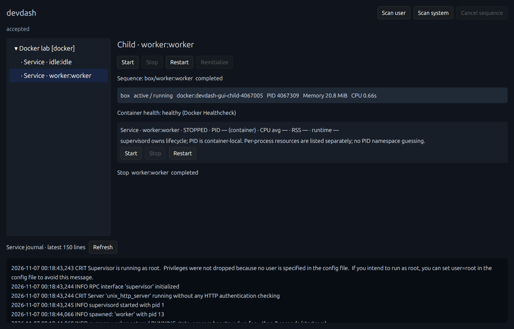

# コンテナ内プロセスとROS 2 launch：設計判断・実装・検証

2026-11-07。既存リポジトリはsystemd専用だったため、Dockerの親Workloadから追加しました。
既存のGroup／Steps、依存診断、GUI／Core分離、再接続設計を再利用しています。

## 実装した範囲

| 対象 | 識別・監視 | 操作 |
| --- | --- | --- |
| systemd Workload | 従来のscope＋unit | 従来のStart／Stop／Restart |
| Docker Workload | container名、またはCompose project/serviceを毎回再解決。State／Health／基本リソース／ログ | 既存コンテナへのEngine API Start／Stop／Restart |
| コンテナのOSプロセス | Docker topのPID・状態・CPU・RSS | 監視のみ。直接killやexecによる対象サービス起動はしない |
| supervisordの論理サービス | XML-RPCのgroup:name。停止中も取得し、PID変更で論理IDを変えない | startProcess／stopProcess、Stop成功後のStartによるRestart |
| 通常のlaunchプロセス | ProcessStarted／ProcessExitedのAction参照、PID、終了コード | ShutdownProcessによるStop。Start／Restartは拒否 |
| 通常のComposable Node | 所有するComposableNodeContainerのListNodes | Unloadのみ。元のLoadNode要求が分からないためLoad／Reloadは拒否 |
| ManagedComponentsで明示したNode | 元の評価済みLoadNode要求＋固定論理ID＋manager起動世代 | Load／Unload／Reload。実ComponentManagerへ委譲 |

s6、任意のlaunch Actionの再起動、外部ComponentManagerの操作、Lifecycle／独自ComposableNode記述への対応は追加していません。
通常のlaunchプロセスの再起動を無理に可能と表示しないことが、今回の重要な判断です。

## 責務と構成

- `model.rs`: Docker参照、controller参照、ContainerReady Gateを追加。コマンド・環境・再起動ポリシーは複製しない。
- `runtime.rs`: systemd／Dockerの明示的な振り分けとcontrollerへの委譲。登録式プラグイン機構は作らない。
- `docker.rs`: Engine API、安定した識別子の再解決、コンテナ／OSプロセス観測、既存controllerへのRPCクライアント実行。
- `children.rs`: Process／Service／Componentと、現在利用できる個別操作を表す小さな観測モデル。
- `engine.rs`: 子操作も既存のグローバルBusy／Cancel／結果管理へ載せる。子要素をGroupのStepsにはしない。
- `inspection.rs`: systemd unitだけを診断する。Dockerを含むGroupには検査対象外であることを明示する。
- `bridges/roslaunch`: 独立したPythonパッケージ。ROSのlaunch読み込み・実行・イベントとComponentManagerサービスを利用する。
- GUI: 親Workload → 論理サービス／launchプロセス → Componentの階層、種別、操作能力、取得元のPID名前空間を表示する。

コンテナ内部の依存グラフや起動シーケンスはCoreに追加していません。
Start Groupは従来の4種類のStepsだけを実行し、コンテナ内で何が起動するかはコンテナの定義とSupervisor／launchが決めます。
子操作は個別操作であり、GroupのGateを再評価しません。競合する親・子・Group操作はグローバルで一つに制限します。

Restartを複数のcontroller APIで実現する場合も、一つの発行済みBackend操作として扱います。
Cancelはその発行済み操作を中断せず、完了／失敗を追跡します。途中失敗のロールバックや自動修復はありません。

## Dockerの識別、監視、Health

container IDを設定の正本にせず、名前かCompose project/serviceを設定します。
Compose one-offを除外し、複数レプリカへ解決される場合は勝手に一つを選ばず拒否します。
参照先が消えても設定から削除せずNot Foundとして保持します。devdashはコンテナを新規作成しません。

操作を発行するときは解決済みIDを固定します。子操作にはcontainer ID＋StartedAtとcontrollerのepochを付け、
コンテナの再作成だけでなく、同じIDのRestartでも古いハンドルを拒否します。
Supervisorが再びPID 1になっても、親コンテナの開始時刻の変更で識別できます。
GUIも選択中の子のepochが変わると選択を解除し、操作対象が親や別のActionへ暗黙に変わらないようにしています。

Dockerの状態変化は現在1秒間隔の観測です。コンテナごとの未知サービスを親Workloadへ自動Importすることはありません。
Docker Scan／Import画面は未追加で、親の登録はYAMLで行います。

ContainerReady Gateは次の条件です。

- Healthcheckあり: Runningかつhealthyを待つ。unhealthy／starting／paused／restartingはReadyではない。
- Healthcheckなし: Runningを待つ。必要なら従来のManual Gateも併用する。
- 内部サービスの状態を集約してReadyを再定義しない。
- 個別Start／RestartはGateを迂回する。

Readyの問い合わせはコンテナのinspectだけで判断し、内部controllerやリソース取得の失敗を待ち条件へ混ぜません。

コンテナ単位のCPU時間・メモリはstats、プロセス単位の情報はtopへ委譲します。
CPU%はpsの**生存期間平均**、RSSはKiBからbytesへ変換した値です。瞬間使用率や時系列ではありません。
Docker側PIDはdaemonが見ている名前空間のもの、SupervisorのPIDはコンテナ内のものとして別に表示します。
名前／PIDを推測して論理サービスへCPUを帰属させず、OSプロセスの行でリソースを確認する方式です。
Composable NodeのPID／CPU／メモリは独立には割り当てません。

## Supervisorへの接続

supervisordのUnix SocketへXML-RPCを使います。コンテナ内では、Engine execで一回だけPython stdlibのRPCクライアントを実行します。
これは対象サービスの実行や常駐Agentの導入ではなく、既存Supervisorへの操作委譲です。監視のOSプロセス一覧自体はDocker APIのみです。
Python 3とstdlibが必要で、別のパスの場合はcontroller.pythonで指定できます。

起動定義やautorestart／stopwaitsecs等をdevdashへ複製しません。
RestartはstopProcess(wait=True)の成功後にstartProcess(wait=True)を実行します。
サービス名は取得済みgroup:nameとの完全一致で確認し、ワイルドカードや全サービス操作は許可しません。
途中でSupervisor PIDが変わったと分かる場合は、後続の操作を送りません。

ただしXML-RPCにインスタンスUUIDや原子的Restartはありません。単一コンテナ内でのSupervisor PID再利用や、
検査と次のRPCとの間の交代まで完全には排除できません。タイムアウト・切断時も要求が適用される可能性があり、自動再試行は行いません。
コンテナのRoot権限や特権デーモンを新たに作る方式ではありません。利用者のDocker接続権限と、既存コンテナの実行ユーザー／socket権限に従います。

## ROS 2で確認した重要な制約

ROS 2 Jazzyの実環境で以下を再現しました。

1. ShutdownProcessで停止すると、launchの停止手順でProcessExitedが返る。respawn=Trueでも、この明示的停止では再起動されない。
2. 同じExecuteLocal Actionをもう一度executeすると拒否される。
3. 新しいActionなら別PIDで起動できるが、元のActionに紐付いたon_exit等は自動では引き継がれない。

したがって、既存Actionのprivateフラグをリセットする、deepcopyする、launch全体を再評価して同じプロセスを探す、
ROSグラフからPIDを推測する方式は採用しません。通常のlaunchプロセスは監視＋停止です。
動的に生成されたプロセスも、実際に届くlaunchイベントから取得します。未実行の条件付きActionを勝手に起動可能にはしません。

通常のComposable NodeはListNodesだけではplugin・parameters等の元のLoadNode要求を復元できません。
アンロードだけは委譲できますが、再ロードは明示的なManagedComponentsに限定しました。
元のComposableNode記述をnativeの評価関数で評価し、ROSメッセージとして保持するため、YAMLへの定義複製は不要です。
この連携ではlaunchファイルの小さな変更が必要です。通常のラッパーによる監視・停止には変更不要です。

Owned managerは同じLaunchServiceのComposableNodeContainer Actionから特定します。ROSグラフを使ったPID推測は行いません。
managerの再起動時は子の世代を変更し、自動再ロードせず明示操作を待ちます。
ROSサービスには世代条件付きの原子的な操作がないため、managerの同時再起動との競合を完全には防げません。
Lifecycle／独自Node記述の扱いや、通常のActionの再起動Factoryは、別途仕様と実証が必要です。

## Bridgeの通知

BridgeはUnix Socket（0600）でsnapshot／operate／watchを提供します。UUIDとsequenceを持ち、変更時にwatchクライアントへ通知します。
watchの通知と古いepochの拒否を実テストしています。

現在のCoreはcontrollerのSnapshotをポーリングし、子の状態変化をイベントログとGUIへ反映します。
**Coreはまだwatchを常時購読していません。** 短い中間状態の捕捉や、Docker execを介した常時ストリームと再接続は後続項目です。
独立Bridgeとしてはdevdash以外のクライアントからも利用できます。

## 設定・起動例

- [Docker／supervisord設定](../examples/docker-supervisor.yaml)
- [systemd上のROS Bridge設定](../examples/roslaunch-bridge.yaml)
- [Bridgeを起動するuser unit例](../examples/systemd/robot-launch-bridge.service.example)
- [Bridgeの導入・ManagedComponentsの宣言](../bridges/roslaunch/README.md)

```bash
cargo run -- validate examples/docker-supervisor.yaml
cargo run -- daemon --config examples/docker-supervisor.yaml
cargo run --features gui --bin devdash-gui

# statusのchildrenに表示された論理IDとepochを指定する。
cargo run -- child stop perception 'worker:worker' --epoch '<current-epoch>'
```

controllerを省略したDocker Workloadは、内部OSプロセスの監視のみです。
既存のDocker HealthcheckとSupervisor／launchの定義を利用してください。

## 検証結果と再実行

Ubuntu 24.04 / Rust 1.95.0 / Docker Engine 29.1.4（API 1.52、通信は1.44へ交渉）/ Supervisor 4.3.0 / ROS 2 Jazzyで検証しました。
ROS側はrclcpp_components 28.1.22を含む既存の開発イメージを使い、ネットワークなしの専用コンテナで実施しています。

- Rust通常テスト61件。従来のCore・再接続・依存診断・認可に加え、Docker APIフレーム、Ready、設定、子操作の競合／Cancelなど。
- 実systemd3件。専用runtime user unitのみで既存のシーケンスと監視を確認。
- 実Docker1件。専用コンテナでSupervisorの個別操作、停止中の論理サービス、Health分離、PID変更、古いepoch、Compose再生成を確認。
- ROS実証2系統。通常Actionの再実行制約と、Bridge／実ComponentManagerのロード・アンロード・再ロード、外部アンロードの観測、通知。
- GUI既存9シナリオに加え、Docker子操作5シナリオ。実クリックの要求・応答、状態、PID、epoch、画面と後片付けを確認。

ビルド、clippy（警告をエラー扱い）、rustfmt、Python構文チェックも成功しました。独立Bridgeのwheel作成とMIT／Apacheライセンスファイルの同梱も確認しています。
専用テストコンテナとuser unitは検証後に停止・登録解除します。重要な既存サービスや既存コンテナは変更しません。

```bash
cargo test --locked --no-default-features
cargo test --locked --test systemd -- --ignored --nocapture
cargo clippy --locked --features gui --all-targets -- -D warnings
cargo build --locked --features gui --bins -j 4

# Supervisorの専用イメージ。常駐Agentを製品へ導入するものではない。
docker build -t devdash-supervisor-test:4.3.0 \
  -f tests/fixtures/supervisor/Dockerfile tests/fixtures/supervisor
cargo test --locked --test docker -- --ignored --nocapture
python3 tools/gui_children_e2e.py --run
python3 tools/gui_e2e.py --run

# ROSは任意。初回はJazzyの開発環境イメージを作る。
docker build -t devdash-ros-test:jazzy -f tests/fixtures/roscomponents/Dockerfile .
docker run --rm --network none --cpus 2 --memory 2g --workdir /tmp \
  --mount type=bind,source="$PWD",target=/devdash,readonly \
  devdash-ros-test:jazzy bash -lc \
  'source /opt/ros/jazzy/setup.bash; python3 /devdash/tools/run_roslaunch_tests.py'
```

ROSテストはテスト用の小さなC++コンポーネントを一時ディレクトリへビルドし、専用domainを使います。
実機ROS環境へ直接接続するテストではありません。GUIテストはX11／Xephyr、Pillow、libXtst等が必要です。

GUIの要求／応答と画面は`target/gui-children-e2e/`、既存GUIは`target/gui-e2e/`に保存します。
ROSテストは一時ディレクトリを終了時に削除します。今回の結果の抜粋は次のとおりです。

```text
native_stop_suppresses_respawn: true
same_action_restart_supported: false
fresh_action_can_start: true
original_targeted_handlers_transfer_to_fresh_action: false
component_load_unload_reload: true
original_request_preserved: true
ordinary_component_unload_only: true
process_stop_without_restart: true
stable_logical_id: true
stale_epoch_rejected: true
watch_notifications: true
```



テスト用コンテナ内のSupervisorログを表示しています。GUI／Coreをrootで起動する設計ではありません。

## 残る範囲

- 通常のExecuteProcess／Nodeの個別Start／Restart。適切なAction Factoryとイベントハンドラの世代管理が必要。
- s6 Adapter、Docker Scan／Import画面、スケールしたCompose serviceの複数実体管理。
- CoreのBridge watch購読、Dockerイベントの取り込み、詳細な外部操作の相関。現在はポーリングと弱い直近要求の推定。
- PID名前空間を検証した上でのSupervisorサービスとOSプロセスのリソース対応付け。
- Lifecycle／独自Composable Node、既存外部ComponentManager、任意のlaunch拡張、Humble等の別distro。
- 同じPIDの再利用や、ROSサービス／XML-RPCの検査後の交代に対する完全な原子性・exactly-once保証。
- リモートDocker、認証付きHTTP Supervisor、container内Pythonがない環境。現在はUnix Socket参照を基本にする。

## 調査した一次資料

- [Docker Engine API v1.52](https://docs.docker.com/reference/api/engine/version/v1.52/): inspect／top／stats／exec／logsとライフサイクル操作。
- [Supervisor XML-RPC API](https://www.supervisord.org/api.html): getAllProcessInfo、getPID、startProcess、stopProcessとwait。
- [Jazzy ExecuteLocal](https://github.com/ros2/launch/blob/jazzy/launch/launch/actions/execute_local.py): Actionの一回限りの実行、ネイティブ停止とrespawn。
- [Jazzy LaunchService](https://github.com/ros2/launch/blob/jazzy/launch/launch/launch_service.py): 同期の外部向けemit_eventと、イベントループ内のLaunchContext APIの区別。
- [Jazzy LoadComposableNodesと要求評価](https://github.com/ros2/launch_ros/blob/jazzy/launch_ros/launch_ros/actions/load_composable_nodes.py): 元のcontext内での要求生成。
- [ListNodes](https://github.com/ros2/rcl_interfaces/blob/jazzy/composition_interfaces/srv/ListNodes.srv)、[LoadNode](https://github.com/ros2/rcl_interfaces/blob/jazzy/composition_interfaces/srv/LoadNode.srv): 取得できる情報と再ロードに必要な情報の違い。
