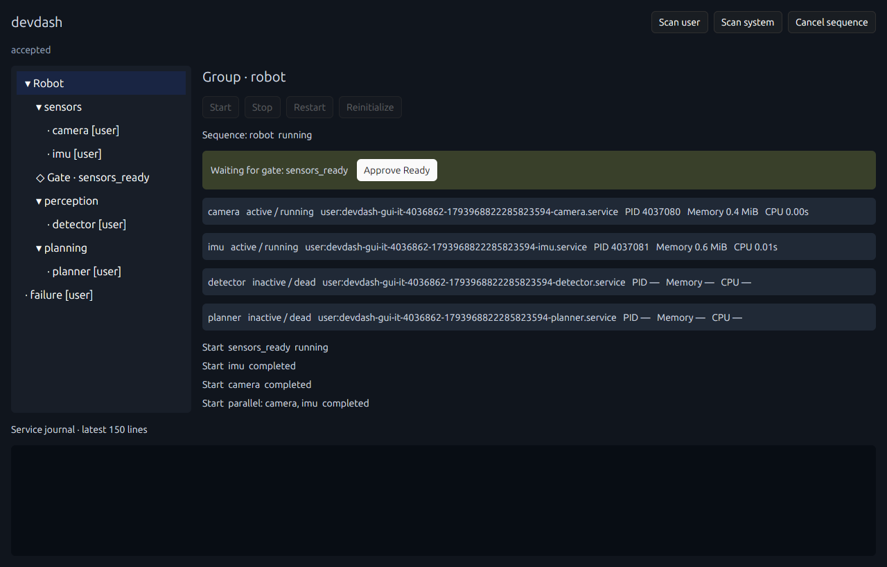
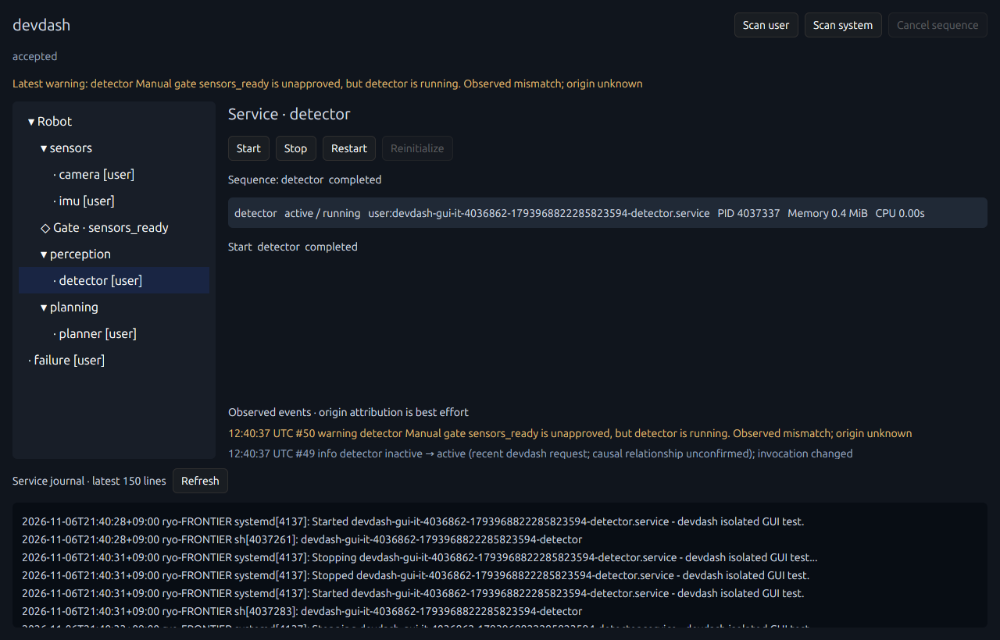
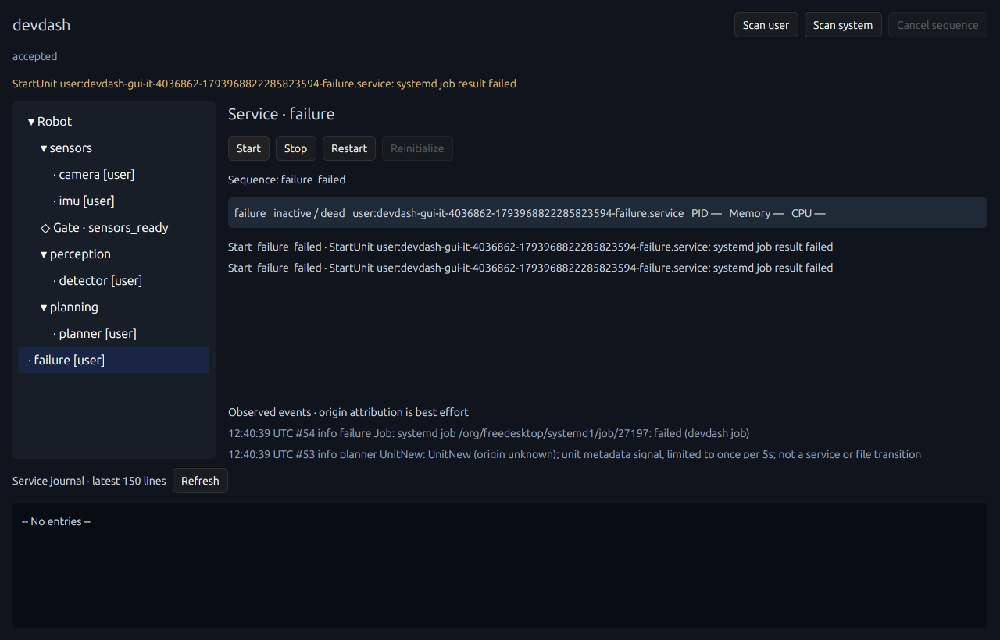

# manager再接続とGUI操作テスト

2026-11-06、Ubuntu 24.04.2 / Rust 1.95.0 / GPUI Kit 0.8.1で検証。

## 追加した振る舞い

system/userごとに、接続・イベント購読・ジョブ相関を一つの接続世代として保持します。
managerの名前所有変更、観測接続または制御接続の切断を検出すると、その世代は利用不能になります。
その後1秒から再試行し、失敗時は2、4、8、最大10秒の間隔に延ばします。各接続試行は最大5秒です。
両managerが起動時に不在でもCoreは起動し、GUI／CLIへ理由を表示しながら接続を再試行します。

新しい世代は、以下の準備が済んでから公開します。

1. 制御用・観測用の接続を新規作成し、managerのunique nameを取得する。
2. 名前所有と両接続の喪失を監視し、観測用のsignal購読を開始する。
3. 両接続でSubscribeを完了する。
4. 名前所有者が変わっておらず、監視も生きていることを確認する。

操作・状態取得・依存取得のD-Bus要求は、その世代のunique nameへ送ります。
操作の途中で名前を再解決して、新しいmanagerへ要求を送り直すことはありません。
購読準備中・接続喪失中の新規操作は拒否し、GUIでも影響するscopeの操作ボタンを無効にします。
別scopeのmanagerが健全であれば、そちらの操作は引き続き可能です。

## 中断したシーケンス

Coreは操作開始時に対象scopeの接続喪失tokenを取得します。このtokenは再接続しても復活しません。
シーケンスはStepの境界で喪失を確認し、Gate待機中も喪失を待ち受けます。
発行済みのWorkload／Parallel操作を積極的にキャンセルすることはなく、結果または追跡喪失を確認します。

- managerを失った保留操作・シーケンスは、結果不明のFailedとして終了する。
- 後続StepをSkippedにし、Busyを解放する。
- Gate待機中に失われた場合も終了し、復旧後の承認だけでは続行しない。
- 再接続に伴うStart／Stop／Restartや、中断したシーケンスの再開は行わない。
- 再操作には、利用者による新しい明示的な要求が必要。

取得・解析・拒否判断の分離は従来どおりです。再接続をSteps実行用DAGやサービスの復旧処理へ発展させていません。
通常のManual承認の保持、Reinitializeの承認リセット、boot IDによる承認の寿命も維持しています。

## 監視と診断の復旧

喪失時と復旧時に依存診断を無効化して取り直します。
喪失前に取得を開始した診断で、新しい世代のキャッシュを上書きしません。

Observationへ接続世代を付け、復旧後の最初の観測を新しい基準値として扱います。
たとえポーリングの間に切断・復旧した場合でも、世代が変わっていれば過去の状態遷移や再起動を推測しません。
旧世代のInvocationIDや別名の相関情報を、新世代の欠損値へ持ち越すことも避けています。
現在の稼働状態と未承認Gateの不整合は、引き続き観測・警告します。

Reconnectedイベントと履歴欠落を記録します。監視が健全に戻っても、過去の欠落を解消したことにはせず、
`monitor_gap`に保持してGUIへ表示します。Core再起動で、このメモリ内の履歴と欠落表示はリセットされます。

UnitNew／UnitRemovedはメタデータのロード・GCでも発生し、serviceのStart／Stopやunitファイルの削除を意味しません。
取得処理が生む繰り返しでログが埋まらないよう、登録unitごとに5秒に1件まで情報ログへ記録します。
JobRemoved、実状態の変化、Not Found、Gate警告、接続喪失／復旧はこの抑制の対象外です。

## テストと実行方法

```bash
cargo test --locked --no-default-features
cargo test --locked --test systemd -- --ignored --nocapture
cargo clippy --locked --features gui --all-targets -- -D warnings
cargo build --locked --features gui --bins -j 4

# 既存の起動・Scan表示テスト。サービス操作はしない。
python3 tools/gui_smoke.py

# 専用ダミーuser unitを作成・操作し、終了時に停止・登録解除する。
python3 tools/gui_e2e.py --run
```

通常のRustテスト54件、実systemdテスト3件、計57件が成功しました。
GUI E2Eは別途9シナリオ、起動・Scanテストも成功しました。
GUI込みビルド、clippy（警告をエラー扱い）、rustfmt、Pythonの構文チェックも成功しています。

### 専用D-Busによる回帰テスト

[tests/events.rs](../tests/events.rs)はサービス自動起動を無効にした二つの専用バスを使います。
ホストのmanagerは再起動・切断しません。既存5件に加え、以下を検証しました。

- LoadUnit応答待ち中の喪失でも操作準備を中断し、起動要求を発行しないこと。
- 別ownerへの交代、Subscribe途中の操作拒否、両接続での再Subscribe。
- user側の喪失中もsystem側の同名unitを操作できること。
- 同じ安定アドレスでのdbus-daemon再起動と監視復旧。
- 起動時に両managerが不在でもCoreが起動し、後から接続できること。
- 中断した操作が再発行されず、Gateで終了したシーケンスも復旧後の承認では再開しないこと。
- 接続世代変更をまたいで、状態変化を推測しないこと。
- 繰り返しの登録unitメタデータsignalがジョブ履歴を埋めないこと。

[tests/inspection.rs](../tests/inspection.rs)には、旧世代のInvocationIDを新しい基準値へ持ち越さない回帰テストも追加しました。

### 実際のGUIからの操作

[tools/gui_e2e.py](../tools/gui_e2e.py)はGPUIをXephyr内で起動し、実際のマウスクリックを送ります。
操作要求はGUIだけが送ります。記録用Unix Socketプロキシで要求・応答を確認し、読み取り専用のIPCで実状態・PID・進捗を照合します。
スクリーンショットについては今回目視でもGate、警告、ジョブ失敗とログの表示を確認しました。

1. Robot StartでSensorsが稼働し、Manual Gateで待つ。
2. GUIを閉じても待機が続き、新しいGUIからApprove Readyすると残りが起動する。
3. PerceptionだけRestartし、SensorsのPIDが変わらない。
4. Robot Restartで承認を再利用し、逆順Stop・正順Startが完了する。
5. Reinitializeで承認をリセットし、GateでCancel。後続は起動せず、Sensorsは維持される。
6. 個別StartでGateを迂回し、Gate不整合の警告と選択サービスのjournalを表示する。
7. 個別Restartを単一操作として実行し、PIDが変わる。
8. 専用の失敗unitの起動ジョブ結果をFailedとして表示し、他サービスへ復旧操作を送らない。
9. Group Stopで配下が停止する。

テスト後のサービス停止、失敗状態の解除、runtimeリンク削除、LoadState=not-foundも検証します。
`devdash-gui-it-<pid>-<time>-*`だけを操作します。初期実装のサンプルunitや、利用者のconfigは使いません。

実行には、systemd user managerに接続できるLinuxユーザーセッション、X11のDISPLAY、Xephyr、
xwininfo、Python Pillow、libXtstが必要です。現在のテストは1280×820のウィンドウとダークテーマを前提にしています。
GUIの配置やテーマを変更した場合はクリック位置も更新してください。期待する要求が送られなければ失敗します。

スクリーンショット・各時点のSnapshot・要求／応答・後片付け結果は`target/gui-e2e/`に保存します。
`result.json`は全シナリオと後片付けが完了してから作成されます。失敗時は`failure.txt`と、取得できれば画面・Snapshotを保存します。







## 制限

- 全イベントを保つ監査ログではありません。状態は1秒間隔の観測です。
- 明示的にD-BusのGUIDまで固定したアドレスは、そのバスの個体へ固定する設定として尊重します。
  バス自体を入れ替える運用には通常の安定したUnix Socketアドレスを使用してください。設定されたGUIDを黙って外しません。
- 初回接続はscopeごとに最大5秒の待ちがあり、Coreの初期化が遅れる場合があります。
- 再接続試行中の設定変更、検査直後の他クライアントの操作まで原子的には防げません。
- 実際のsystem manager再起動、実機Polkitの認証画面、認可された実systemサービス操作、ROS 2実機、Waylandは未検証です。
- GUIからのmanager切断／復旧の画面操作はE2E対象外です。再接続と監視健全性は専用D-Bus＋IPCで検証しています。
