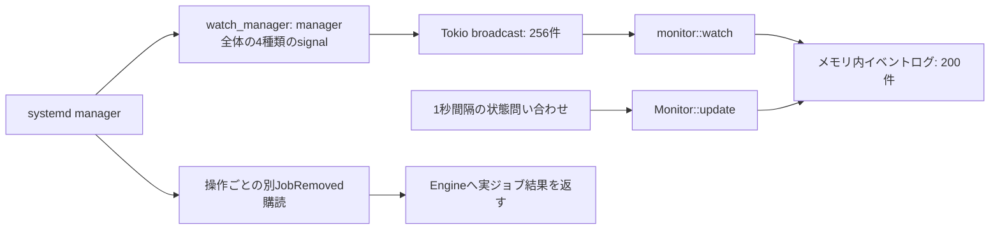

# セルフレビュー：依存診断の責務とsystemdイベント追跡

## 続編：再接続とGUI操作テスト（2026-11-06）

managerの自動再接続・再Subscribeを追加しました。接続世代とunique nameで操作を固定し、
中断したジョブやGate待機のシーケンスを新しいmanagerで再開しません。
通常54件＋実systemd3件、GUI E2E 9シナリオが成功しました。
最新の振る舞い、画面、制限は[manager再接続とGUI操作テスト](reconnection-and-gui-tests.md)を参照してください。
以下は自動再接続追加前の修正結果と、元のレビュー記録です。

## レビュー後の最初の修正結果（2026-11-03）

**F1〜F9を修正し、回帰テストを追加しました。以下の元レビューは修正前の記録として残しています。旧コードの行番号・関数名・再現出力は現在の実装を表しません。**

| 指摘 | 修正内容 | 回帰検証 |
| --- | --- | --- |
| F1 | managerのowner変更・接続断を追跡し、保留操作を結果不明のFailedとして終了。Busyを解放し、監視不能のscopeへの追加操作を拒否 | 一時D-Busでowner喪失とCancel。完了・健全性低下・再発行しないことを確認 |
| F2 | 広域監視に制御とは別のD-Bus接続を使用。受信ループのsleepを削除し、操作側もmethod返信前の完了通知を排出 | UnitNew 300件と無関係JobRemoved 300件のバースト中に操作完了 |
| F3 | method発行中と返信済みのジョブを明示的に保持し、返信と完了通知のどちらが先でもjob pathで照合。待ち時間による推測を廃止 | 完了通知後250ms遅れて返信。自分のジョブを一度だけRequestedとして記録 |
| F4 | 診断キャッシュにCore／Backendの世代を保持。無効化後に届いた古い結果を公開しない。承認変更も無効化 | 検査中の無効化と再読み込み、操作前検査の陳腐化、承認変更 |
| F5 | 部分Groupから外へ到達する起動要求と、該当Workloadに関係する未承認Manual Gateを警告 | 部分Groupの警告と全体Groupのエラーを区別 |
| F6 | Unknownを警告の解消と扱わず、最後の既知状態を保持。InvocationIDの欠落だけでは再起動と推定しない | Active→Unknown→Activeで同じGate警告を繰り返さない |
| F7 | 初期状態取得前に受信を開始。ポーリングを別タスクへ分離。イベント種別・受信時刻・相関・job結果と監視健全性を保持 | 初期取得中のイベント、遅いポーリング中の通知、監視readerの所有と終了 |
| F8 | 操作前検査は選択Group配下を探索開始点にする。要求unitと未取得unitを診断へ明示 | 無関係なWorkloadを開始点へ混ぜないこと、取得範囲の表示 |
| F9 | 操作時間帯に受信したReloadingの開始・終了をwarningで記録 | 保留操作中の両signalを一時D-Busで確認 |

DependencyInspectorを巨大な管理クラスへ統合せず、責務は次の境界を維持しました。

- BackendがD-Busの事実と取得範囲を集める。
- `inspection::inspect`がI/Oなしで診断する。
- Engineが世代管理・キャッシュ公開・操作拒否を担当する。既知のstaleな操作前診断も拒否する。
- `Config::manual_followers`がフローの共通照会を提供する。
- `systemd_events`はmanager接続の健全性と要求／ジョブ相関だけを担当し、サービスを制御しない。
- Monitorは登録済みWorkloadへの対応付けと通知を担当する。Stepsの実行順序は従来どおり。

通常テスト47件、専用unitを使った実systemdテスト3件、計50件が成功しました。GUIを含むビルド・clippy・rustfmtも確認しています。
回帰テストは[events.rs](../tests/events.rs)、[inspection.rs](../tests/inspection.rs)、
[systemd_events内の単体テスト](../src/systemd_events.rs)にあります。実systemd検証は既存の専用user unitのみを操作しました。

残る制限:

- manager喪失後は自動再接続せずCore再起動が必要。既存サービスには何もしない。
- 相関バッファは256件に制限し、超過時は監視喪失・結果不明として扱う。全履歴を保持する監査基盤にはしない。
- 観測用broadcastが溢れた場合は履歴欠落を保持して表示する。操作完了の専用購読とは独立。
- 状態変化の直近5秒の要求との相関は弱い推定。イベント受信時刻はsystemd内部の発生時刻ではない。
- manager再読み込みを観測できた検査の陳腐化は拒否するが、検査・実行の原子的なトランザクションはない。検査直後の並行変更までは防げない。
- 部分Groupから外への起動要求は警告とする。親のGateを部分Group操作の必須条件へ変えてはいない。
- バックグラウンドの全体検査は全登録unitから取得を共有するため、巨大な構成では取得予算に達し得る。操作直前は選択Groupから取り直す。
- 再接続後の購読復旧、実機Polkitの認証画面、実ROS 2環境での終了処理は未検証。

最新の運用上の振る舞いは[systemd統合と運用設計](systemd-operations.md)も参照してください。

---

## 修正前のレビュー記録

レビュー日: 2026-11-02
対象: 現在のワークツリー。コミット前の実装を対象とするため、参照行番号は今後変わる可能性があります。
作業範囲: 読み取りレビューと一時ハーネスによる再現確認。本書の追加のみで、製品コードは修正していません。

## 結論

**依存グラフを診断に限定し、Steps実行へ持ち込んでいない点は維持してよいです。一方、イベント追跡はまだ堅牢とは言えません。**

優先したいのは、Inspectorを大きなクラスへまとめることよりも、managerの所有者変更、イベント取り込みと相関付けの分離、診断結果の世代管理です。
実行エンジンやsystemdの依存関係を再実装する必要はありません。

最初に読むなら、以下の表とF1〜F4を推奨します。

| ID | 優先度 | 指摘 | 確認方法 |
| --- | --- | --- | --- |
| F1 | P1 | managerの名前所有喪失時、保留ジョブが終了せずCancel後もBusyが残り得る | 一時D-Busで再現＋コード確認 |
| F2 | P1 | 全managerイベントの遅い消費が、制御と同じD-Bus接続の受信まで詰まらせ得る | コード・zbus実装／公式文書。負荷再現は未実施 |
| F3 | P2 | 自分のジョブが「要求と対応しない変化」と誤判定される | 一時D-Busで再現 |
| F4 | P2 | 無効化済みの古い診断が、後からstale=falseで公開される | Fake Backendで再現 |
| F5 | P2 | 部分GroupからGroup外へ出る起動伝播が診断されない | 純粋な解析関数で再現 |
| F6 | P2 | 一時的な観測失敗でGate不整合の警告抑制が解除される | Monitorで再現 |
| F7 | P2 | イベント購読開始・受信時刻・監視の健全性が明示されていない | コード確認 |
| F8 | P2 | 選択Groupに無関係なunitが検査予算を消費する | コード確認 |
| F9 | P2 | 操作中の再読み込みを警告するという文書と実装が一致しない | 条件式を確認 |

P1は制御の応答性や操作終了に影響するもの、P2は診断の誤判定・見落とし・鮮度・通知の問題です。
「再現」は問題の条件を構成して現状の振る舞いを確認したという意味で、修正済みという意味ではありません。

## 現在のDependencyInspectorは何を担当しているか

実装には`DependencyInspector`という単一の構造体はありません。機能は次の場所へ分かれています。

| 場所 | 現在の責務 | 評価 |
| --- | --- | --- |
| `Systemd::dependencies` / `read_dependencies` | D-Bus取得、別名の正規化、探索、取得予算、未完了理由 | 読み取りをBackendへ置くのは妥当。ただし「どの辺を追うか」という解析上の方針も含む |
| `inspection::inspect` | Group展開、伝播経路、Gate／順序／Conflicts診断、重要度の決定 | I/Oをしない点はよい。事実の検出と操作拒否の方針が近接している |
| `Engine::inspect` / `refresh_inspections` | 取得の起動、承認状態の入力、診断キャッシュ更新 | 世代・対象・公開順序の管理が不足 |
| `Engine::execute` | 操作直前の再検査、errorがあれば操作拒否、従来Stepsの実行 | 実行順序を変更しておらず境界は守られている |
| `inspection::manual_followers` | Manual Gate後続Workloadの列挙 | 実際には監視でも使うフロー照会。Inspector専用の責務ではない |

現在の流れは次のとおりです。

```text
選択Groupと操作
  → Engineが全登録unitを探索開始点にする
  → BackendがD-Busの依存プロパティと逆方向プロパティを取得
  → inspection::inspectがConfig・承認状態と照合
  → Engineがerrorの有無で実行を許可／拒否
  → 許可された場合のみ、従来の順序付きStepsを実行
```

### 維持してよい境界

- InspectorはStart/Stopを発行せず、unitファイルを書き換えない。
- `After`／`Before`を起動要求として扱っていない。
- `PartOf`等の停止伝播と、`Wants`等の起動伝播を分けている。
- 依存経路で見つけた未登録unitを、自動Importしない。
- GroupのStepsをsystemd targetや実行用DAGへ変換していない。

### 小さく整理するなら

「取得した事実」「その事実の診断」「操作を止める方針」を区別するのがよいです。
新しいTraitやサービスを大量に追加する必要はなく、現在の関数を以下の契約へ寄せる程度で十分です。

1. **取得**: unitと型付きの辺、取得できた範囲、失敗理由、manager世代を返す。
2. **診断**: 選択Group、全Configの参照情報、操作、承認状態、取得結果を受けて診断を返す。I/Oと実行状態を持たない。
3. **適用**: Coreが拒否条件を決める。キャッシュの公開と世代確認もCoreが担当する。

とくに、`Requires`経路を見つけたという事実と、Gate前後の要求順序の矛盾を理由に操作拒否するという方針は区別したいです。
現状の文書は構成上の矛盾を拒否すると明記しているため、その方針自体を直ちにバグとは扱いません。
ただし、これは条件判定・既存Active状態まで含めた「systemdが必ず失敗する」という証明ではありません。

`manual_followers`はConfig／フローの共通照会として扱えばよく、監視がInspector全体へ依存する必要はありません。
探索方向の意味は`Relation`側へ集め、D-Busプロパティの対応表と解析側で別々に意味を定義し続けることも避けたいです。

## systemdイベントは現在どう追跡しているか

**全状態変化をD-Busイベントから追っているわけではなく、managerイベントとポーリングの併用です。**



- 購読対象は`JobRemoved`、`UnitNew`、`UnitRemoved`、`Reloading`。
- `JobNew`や登録unitの`PropertiesChanged`は購読していない。
- ActiveState、SubState、InvocationIDはポーリングで比較する。
- 自分の操作は、method返信後に`scope + job path`を`own_jobs`へ登録する。
- 広域watcherはJobRemoved受信後30ms待ってから`own_jobs`と照合する。
- ポーリング結果の相関は、unitごとの「直近5秒に要求したか」という別の推定。
- 実ジョブ完了を待つ操作用streamと、通知用の広域streamは独立している。

このため、**通知の誤相関と、操作そのものの成功／失敗は別の問題**です。F3では通知が誤っていても操作自体はCompletedになりました。
また、短い状態変化はポーリングで見えないことがあります。イベントログを完全な監査ログとする設計ではありません。

## F1: managerの名前所有喪失で、保留操作が終わらない

**P1／一時D-Busで再現。**

根拠: [systemd.rs](../src/systemd.rs#L135) のsignal購読と、[operate](../src/systemd.rs#L221) の待機ループ。

再現手順:

1. 専用D-Bus上の擬似managerがStartUnitへジョブパスを返す。ジョブ完了通知はまだ送らない。
2. 擬似managerが`org.freedesktop.systemd1`の名前所有を手放す。バス自体は生かしておく。
3. CoreへCancelする。
4. 確認時点でもCancellingのままで、監視断絶イベントも記録されない。

zbusのSignalStreamは内部でNameOwnerChangedに追随しますが、その変化をdevdashへイベントとして返しません。
したがって、名前所有喪失がそのまま`removed.next() == None`になるとは限りません。
現在の待機ループには旧ownerの消失を検出して終了する経路がなく、完了通知が届かなければ待ち続けます。

Global Busyを保持したままなので、後続のGroup操作・個別操作も拒否されます。
一時ハーネスではCancel後500msの残存を確認しました。永久待ち自体を時間で証明したわけではなく、終端処理がないことはコードから判断しています。

改善案:

- managerのowner／接続世代を明示的に追跡する。
- ownerが失われた場合、保留操作は「結果不明」として終了させ、成功を捏造せずBusyを解放する。
- 診断キャッシュを無効化し、イベント監視の空白を保持する。
- 再接続・再Subscribeは別途判断する。サービス停止、ロールバック、シーケンス再開は行わない。

単なる「ジョブを一定時間で失敗にする」修正は避けたいです。正常な長時間起動ジョブまで打ち切る理由にはなりません。

## F2: 広域イベントの消費を止めると、同じ接続の制御にも影響する

**P1／構造とライブラリ仕様を確認。高負荷でのエンドツーエンド再現は未実施。**

根拠: [watch_manager](../src/systemd.rs#L148) と、[同じConnectionの利用](../src/systemd.rs#L81)。

watcherは未登録unitを含むmanager全体のJobRemovedを受け、**すべてについて30ms待ちます**。
この時間はJobRemovedだけでなく、同じループで処理するUnitNew／UnitRemoved／Reloadingの受信も止まります。
JobRemovedを処理できる上限は待ち時間だけでも約33件／秒で、さらに他の処理時間が加わります。

zbus 5.19.0の受信キューは既定64件です。満杯になると空きができるまで受信が進みません。
ConnectionのCloneは接続を分離せず、操作・照会も同じ受信経路を共有します。
この性質は[zbus公式文書](https://docs.rs/zbus/5.19.0/zbus/connection/struct.Connection.html)とローカルの`connection/socket_reader.rs`で確認しました。

devdashが検出するTokio broadcastのLaggedは、この**後段**の取りこぼしだけです。
上流のD-Busキューで詰まることを、後段の256件のバッファでは解決できません。
前回の統合テストで起きた応答待ちとの因果までは立証していません。

改善案:

- 受信ループからsleepと重い解析を除き、入力を継続的に取り出す。
- 相関付け待ちのデータは別の小さな有界領域で扱う。
- メッセージを増やすだけ、キューを大きくするだけの対処にしない。
- 必要なら制御用と観測用の接続を分ける。ただし先に受信を止める実装を直す。

## F3: 30ms待ちは、自分のジョブを正しく識別する保証にならない

**P2／一時D-Busで再現。**

根拠: [30ms後の照合](../src/systemd.rs#L154)、[method返信後の登録](../src/systemd.rs#L210)。

擬似managerでJobRemovedを送ってからStartUnitの返信を250ms遅らせると、watcherが先に照合してしまいます。
自分の操作がCompletedになっても、次の警告が残りました。

```text
job: systemd job /org/freedesktop/systemd1/job/42: done
(not correlated with a devdash request; origin unknown)
```

返信後に追加された`own_jobs`の項目も、この完了通知ではもう削除されません。
512件到達時には集合全体をclearしているため、蓄積すると他の有効な追跡情報まで捨てます。

改善案:

- method返信とJobRemovedの到着順に依存しない照合にする。
- 未照合完了通知を一時保持し、ジョブ登録と突き合わせる。受信ループで待たない。
- 確定できない場合は「相関待ち／不明」とし、時間経過だけで外部由来へ寄せない。
- ジョブパスによる一致と「直近5秒」という弱い推定を、同じboolに潰さない。

なお5秒窓は、同期間の別操作を自分の操作に見せたり、5秒を越える自分の起動途中の状態変化を不明扱いしたりします。
この近似自体は文書化されていますが、表示の「correlated」は確定情報に見えやすいです。

## F4: staleフラグだけでは、古い検査結果の後着を防げない

**P2／Fake Backendで再現。**

根拠: [Engineの検査・無効化・再公開](../src/engine.rs#L432)。

再現した順序:

```text
古い依存情報を取得済みのrefreshを一時停止
→ invalidate_inspectionsで既存レポートをstale=trueにする
→ Backendの依存情報を変更
→ 古いrefreshを再開
→ 古い内容がstale=falseで上書きされる
```

monitorのdirtyフラグにより、後から再検査される可能性はあります。
しかしその間、古い結果を「古くない」と表示します。手動Checkや操作前検査とバックグラウンド更新の公開順序も制御していません。
承認状態の変化についても、既存レポートを無効化する仕組みがありません。

操作前にキャッシュを使い回さず再取得する点はよいですが、その検査自身も並行した変更と世代照合をしていません。
これはsystemdの完全なトランザクション再現をしなくても対処できる問題です。

改善案: 小さな世代番号を持ち、取得開始時と公開時で一致しなければ古い結果を有効扱いしない。
manager、設定、承認状態のどの入力で検査したかと、操作種別を明確にする。
再検査の無制限な繰り返しではなく、「検査中に変化したので未完了」と返す方針でもよいです。

## F5: 選択Group外へ出る起動依存が黙って除外される

**P2／解析関数で再現。実サービスは起動していません。**

根拠: [選択Groupのplacements](../src/inspection.rs#L143)、[targetがplaces内か確認する分岐](../src/inspection.rs#L191)。

サンプルのcameraから、robotのManual Gate後にあるdetectorへRequiresを追加した依存グラフを入力すると:

```text
inspect(robot, Start)   → gate_bypass error
inspect(sensors, Start) → diagnostics = []
```

後者では、起動伝播先のdetectorが選択Group外なのでGate判定へ入りません。
Group外への停止やConflictsは調べる一方、単純なGroup外への起動伝播は警告しません。
伝播の意味は[systemd.unitの公式仕様](https://www.freedesktop.org/software/systemd/man/latest/systemd.unit.html)を確認しました。

改善案: 「操作対象」と「影響を受ける対象」を区別し、Group外へ出る起動要求を警告する。
登録済みの伝播先であれば、全ConfigからGateとの関係も補足できるとよいです。

**祖先GroupのGateを、子Groupや個別Workloadの起動必須条件に変更する提案ではありません。**
部分木操作・デバッグ時の迂回は維持し、意図しない範囲への影響を見えるようにする修正です。

## F6: 観測不能をサービス状態の変化と一緒に扱っている

**P2／Monitorで再現。**

根拠: [観測失敗をunknownへ変換](../src/engine.rs#L479)、[Gate不整合集合の作り直し](../src/monitor.rs#L91)。

Manual Gate未承認のdetectorについて、以下を入力しました。

```text
Active → 一時的にUnknown → Active
```

同じ稼働状態に対するGate警告が2回記録されました。
Unknownで不整合集合から外れ、観測が戻ると新しい不整合と判断するためです。
通信や権限の問題が繰り返されると、警告を繰り返します。InvocationIDも取得失敗で空になると、変化として記録され得ます。

改善案: 最後に確認できたサービス状態と、現在の観測可否を分ける。
観測不能だけではGate不整合が解消したことにしない。履歴の空白を残し、復帰時に経緯を推測しない。

## F7: 監視の開始・時刻・健全性を明示する必要がある

**P2／コード確認。負荷・起動競合の再現は未実施。**

根拠: [初期状態取得](../src/ipc.rs#L146)、[その後の購読](../src/monitor.rs#L118)、[状態問い合わせ中の受信停止](../src/monitor.rs#L123)。

- 初期状態の取得後にbroadcast受信者を作るため、その間のイベントを受け取る保証がない。
- Backend側watcherもspawnするだけで、全購読が準備できたことを待たない。
- monitorは状態取得をawaitしている間、broadcastを読まない。状態取得が遅いと最大5秒程度遅れ、その後Laggedになることがある。
- 複数signal streamをselectするため、イベントログのIDはsystemdの発生順を示すものではない。
- イベントには受信時刻・manager世代・操作IDがなく、処理時点のRun.statusで「操作中」を判断する。
- 切断は単発のログであり、manager別の監視健全性をSnapshotへ保持していない。ログが200件から押し出されると見えなくなる。

改善案: 購読の準備完了後に基準状態を確定する。初期化中のイベントはバッファするか、空白を明示する。
時刻・scope・job path・job result・相関の確度を小さな型付きデータで保持し、表示時に文章へ変換する。
イベントソーシングや汎用バスは不要です。

また、BackendのwatcherはJoinHandleを保存せずConnectionのCloneを保持しています。
Backendをdropしてもwatcherの寿命を明示的に終わらせられません。現状はプロセス終了に依存します。
再接続を増やす前に、購読タスクの所有者と終了処理を明確にしたいです。

## F8: 全登録unitを先に並べると、選択範囲より先に取得予算を使う

**P2／コード確認。大規模な登録集合での実測は未実施。**

根拠: [全Workloadをseedにする処理](../src/engine.rs#L437)、[256参照／6秒の予算](../src/systemd.rs#L331)。

Planningだけの操作でも、別Groupのuser/system unitを最初からすべて調べます。
無関係なunitの応答遅延や、論理IDの並び順によって、選択対象と必要な依存経路を取得する前に予算を使い切り得ます。
未完了表示はありますが、選択対象のどこまでを確認できたかは分かりません。

改善案: 操作対象を優先してseedにし、必要な起動・停止経路を辿る。
全Configは登録情報やGateの照合に使い、毎回全unitをD-Bus取得することとは分ける。
レポートでは全体件数だけでなく、対象範囲の取得済み／未取得を示す。

## F9: 「操作中の再読み込みは警告する」は現在の条件式にない

**P2／コード確認で確定。**

根拠: [record_backend_eventのlevel判定](../src/monitor.rs#L197)。

warningになるのは`disconnected`、または操作中の未相関`job`だけです。
`reloaded`は操作中でもinfoになります。[運用設計](systemd-operations.md)の「操作中の再読み込みは警告する」と一致していません。

修正は小さく、操作中のreloadedをwarningに含め、そのケースをテストすればよいです。
自動Cancelやサービス停止を追加する必要はありません。

## 次に直す順番

1. **イベント追跡の終端と取り込み**: owner喪失を扱う。受信ループのsleepをなくす。F1・F2。
2. **ジョブ相関**: method返信と完了通知の順序に依存しない照合。F3。
3. **診断の版管理と対象範囲**: 世代番号、古い結果の公開防止、選択Group優先、Group外への起動影響。F4・F5・F8。
4. **観測品質と表示**: Unknownを解消と扱わない、監視健全性・受信時刻を持つ、再読み込みの警告。F6・F7・F9。

最初から単一の巨大なDependencyInspectorや汎用イベント基盤を作る方針は勧めません。
受信、相関、純粋な解析、操作ポリシーの小さな境界を整える方が保守しやすいです。

## 今回行った検証と、まだ行っていない検証

リポジトリ外の`/tmp/devdash-self-review`に一時ハーネスを作成しました。
サービス自動起動を無効化した専用D-Busと既存のCoreバイナリ、Fake Backend、公開解析関数を使いました。
ホストの実systemdサービスには操作を送っていません。一時CoreとD-Busは終了済みです。

確認出力:

```text
CONFIRMED partial-group: root blocked=true, sensors diagnostics=0
CONFIRMED observation-gap: same readiness mismatch warned 2 times across unknown state
CONFIRMED old-publication: invalidated old refresh published stale=false, blocked=false after metadata change
CONFIRMED own-job race: own completed Start generated an uncorrelated warning with 250 ms delayed method reply
CONFIRMED owner-loss: after manager name loss and Cancel, operation remains cancelling; no event-stream gap notification
```

このハーネスは現状の問題をassertするものです。成功終了は「製品が正しい」ことを示しません。
次回の修正では、これらを期待動作をassertする回帰テストとして製品のテストへ移すべきです。

前回の36テスト成功は今回再実行していません。既存テストは基本経路を確認できていますが、返信とsignalの順序逆転、
manager owner喪失、再検査の後着、観測不能を挟んだ警告抑制はカバーしていませんでした。

追加で必要な検証は、64件を越えるsignalのバーストと制御応答、初期状態取得中のイベント、遅いポーリング、
再接続時のSubscribeと世代の切り替えです。実system managerを負荷試験する前に、一時D-Busで検証するのが適切です。

## 参照した一次資料

- [systemd Unit依存関係の仕様](https://www.freedesktop.org/software/systemd/man/latest/systemd.unit.html)
- [systemd D-Bus API](https://www.freedesktop.org/software/systemd/man/latest/org.freedesktop.systemd1.html)
- [zbus 5.19.0 Connectionの受信キューとCloneの仕様](https://docs.rs/zbus/5.19.0/zbus/connection/struct.Connection.html)
- ローカルに取得済みのzbus 5.19.0 `proxy/mod.rs`、`connection/mod.rs`、`connection/socket_reader.rs`
