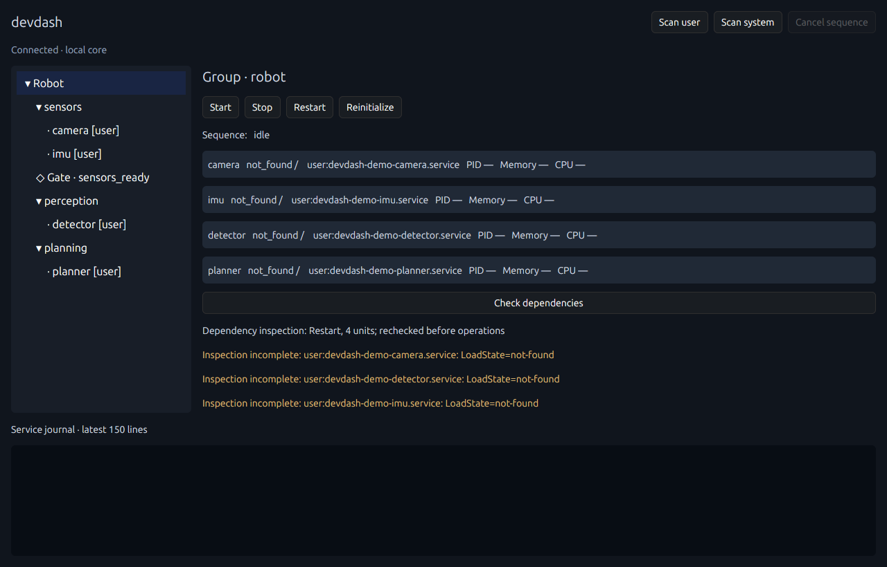

# v0.1 初期実装の検証記録

現在の追加実装・検証結果は[systemd統合と運用設計](systemd-operations.md)を参照してください。[コンテナ・ROS Bridgeの追加記録](container-processes-and-roslaunch.md)もあります。以下は初期実装時点の記録です。

2026-11-02、Ubuntu 24.04.2 LTS x86_64で実施。
Rust 1.95.0 / GPUI Kit 0.8.1 / GPUI snapshot 0.3.10 / zbus 5.19.0。

| 検証 | 結果 |
| --- | --- |
| `cargo build --locked --features gui --bins -j 4` | 成功、CLI/CoreとGPUIバイナリ生成 |
| `cargo test --locked --no-default-features` | Core 19件、IPC 1件成功。実systemdテストは通常はignore |
| `cargo test --locked --test systemd -- --ignored --nocapture` | 専用runtime user unitで1件成功 |
| `cargo clippy --locked --features gui --all-targets -- -D warnings` | 成功 |
| `cargo fmt --all -- --check` | 成功 |
| `devdash validate examples/robot.yaml` | 成功 |
| `devdash validate examples/http-gate.yaml` | 成功 |
| GPUI実画面 | X11 / Xephyr内で起動、Core接続、ツリー展開・選択、Group詳細、Scan一覧を確認 |

画面内のNot Foundは、この表示テストがデモunitを登録せずに実行されたためです。
実画面テストでは既存サービスの起動・停止・Importを行っていません。
`tools/gui_smoke.py`は別X11サーバーで入力と描画を分離し、確認後にGUI、Core、Xephyrを終了します。
再実行にはXephyr（Ubuntuの`xserver-xephyr`）、Python Pillow、xwininfo、libXtstが必要です。
スクリーンショットとログはローカルの`target/gui-smoke/`に出力します。

## Core / IPC

Fake Backendで階層展開、正順Start、逆順Stop、Parallel、部分Restart、全体Restart、
Manual Gate待機と承認、Restartでの承認保持、Reinitializeの承認リセット範囲、
boot ID付き永続化、HTTP成功・再評価・タイムアウト・キャンセルを検証しました。

キャンセルについては即時Cancel、Gate待機、発行済みParallelの完了追跡、
Restart停止中・起動中の両方を検証しました。
途中失敗の後続スキップ、停止失敗時の起動フェーズ抑止、ロールバックしないこと、
個別Restart、Gate迂回、system scope操作拒否、競合拒否、設定不正検出も確認しました。

IPCではクライアント切断後のGate維持、別接続での承認、Scanだけでは設定が変わらないこと、
明示Importとバックアップ、未知unitのImport拒否、Core二重起動拒否、残存Socket再利用を検証しました。

## 実systemd

一意な`devdash-it-<pid>-<timestamp>-*`をruntime user managerに登録しました。
専用camera/imu/detector/plannerはsleepのみ、failureはoneshotのfalseです。

1. Robot Startでcamera/imuがActive、Manual Gateで待機、detectorはInactive。
2. 承認後にdetector、plannerが起動。
3. PerceptionのみRestartし、cameraのPIDが変わらないことを確認。
4. Robot Restartで逆順停止と正順起動の結果を確認。
5. ReinitializeでGateまで戻り、Cancel後にdetectorがInactiveのまま、cameraはActiveのままであることを確認。
6. 停止中も含むScan、存在しないunitのNot Foundを確認。
7. failureのStartが実際の`JobRemoved`の`failed`を報告することを確認。
8. 専用unitを停止・失敗状態リセット・runtime登録解除。

初回の検証で見つかった、Subscribeの重複発行、LinkUnitFilesの返り値、
テストのunit登録解除方法を修正しました。失敗時に残った専用リンクと専用サービスも後片付け済みです。
既存の実サービスの停止や設定変更は行っていません。

## 検証していない範囲

Ubuntu 22.04、Wayland、複数GPU環境、OSを実際に再起動した前後の動作は未検証です。
boot ID変更はCoreテストで再現しています。
GUIでのStart/Stop/承認ボタンは型チェックと共有IPCのテストで確認し、実画面テストでの
サービス操作は行っていません。実サービス操作のシナリオは上記systemd統合テストで確認しています。

## Steps実行エンジンの整理後

実行順序の組み立てを`plan`、Step実行を`run_step`、進捗更新を`track`へ分けました。
実行結果とキャンセル情報は一つのMutexで更新します。設定・IPC形式・起動停止順序は維持しています。

整理後に上記のCore 19件、IPC 1件、実systemd 1件を再実行し、すべて成功しました。
追加テストでは、StepとParallel内Workloadの進捗が重複しないこと、Cancel後も発行済みジョブの
失敗結果を保持して後続をスキップすることを確認しています。GUIを含むビルドとclippyも再確認しました。
